# 📧 Cankal Software - Email Phishing Analysis & Threat Forensics Tool

## 1. Executive Summary & Vision
Phishing remains the number one initial attack vector for enterprise breaches, ransomware deployment, and credential theft worldwide. Cybercriminals exploit human psychology, domain spoofing, obfuscated URLs, and malicious attachments to bypass standard spam filters.

The **Cankal Software Email Analysis Tool** (`/email-analysis`) is a free, privacy-first, passive cybersecurity scanner designed to empower both non-technical users and IT security teams. Users can safely upload an Outlook binary message (`.msg`), a standard MIME message (`.eml`), or paste raw email transport headers to receive:

1. **Automated Header Stripping & Server Forensics**: Chronological MTA hop-by-hop analysis, comparing declared "From" headers against real originating mail server IP addresses.
2. **Visual Red/Green Security Indicators**: Instant, high-contrast badges for SPF, DKIM, DMARC, Display Name spoofing, and reverse DNS (PTR) alignment.
3. **Content & Linguistic Heuristics**: Automated detection of urgent psychological pressure, credential harvesting hooks, spelling/grammar inconsistencies, and suspicious attachments.
4. **Deep Link Inspection & Safe Sandbox Previews**: Unmasking redirection chains, detecting anchor-to-destination mismatches, and rendering secure visual thumbnails/screenshots of final landing pages via a headless sandbox.
5. **Curated OSINT & Threat Intel Tool Directory**: Fast-access reference to industry-standard external sandboxes and reputation databases.
6. **Dummy Guide for Non-Tech Users**: Plain-English, step-by-step guidance on how to export, inspect, and evaluate suspicious emails safely.
7. **Cybersecurity Remediation CTA**: A high-converting call-to-action inviting users to engage Cankal Software for business incident response, mailbox forensics, and enterprise email security hardening.

---

## 2. System Architecture & Process Flow

```mermaid
flowchart TD
    User([User / Employee / Security Analyst]) -->|Uploads .msg / .eml or Pastes Headers| UI[Email Analysis UI /email-analysis]
    
    subgraph IngestionAndSanitization [1. Safe Ingestion & Stripping Pipeline]
        UI -->|In-Memory Buffer| APIRoute[POST /api/email-analysis]
        APIRoute --> FileDetect{File Type?}
        FileDetect -->|.msg| MSGParser[MSGReader OLE Parser]
        FileDetect -->|.eml| EMLParser[Mailparser MIME Parser]
        FileDetect -->|Raw Text| HeaderParser[RFC 822 Header Parser]
        MSGParser --> NormalizedData[Normalized Header, Body & Attachment Manifest]
        EMLParser --> NormalizedData
        HeaderParser --> NormalizedData
    end

    subgraph ForensicEngine [2. Header Forensics & Server Alignment Engine]
        NormalizedData --> HeaderFrom[Extract 'From', 'Reply-To', 'Return-Path']
        NormalizedData --> ReceivedHops[Parse Chronological 'Received' Hops]
        ReceivedHops --> OriginIP[Extract Originating MTA Server IP & Reverse DNS]
        
        OriginIP --> SPFCheck[SPF Validation & DNS TXT Lookup]
        NormalizedData --> DKIMCheck[DKIM Cryptographic Signature Check]
        NormalizedData --> DMARCCheck[DMARC Policy & Alignment Check]
        
        HeaderFrom --> DisplaySpoofCheck[Display Name vs Real Address Comparison]
        OriginIP --> GeoIPASN[IP Geolocation, ASN & ISP Abuse Check]
        
        HeaderFrom --> DomainIntel[Domain & Mailbox Intelligence Engine]
        DomainIntel --> MXCheck[MX Record Health & MTA Fingerprinting]
        DomainIntel --> CatchAllCheck[Catch-All & Disposable Domain Sentinel]
        DomainIntel --> MailboxType[Webmail vs Corporate & Role Account Detection]
        
        SPFCheck & DKIMCheck & DMARCCheck & DisplaySpoofCheck & GeoIPASN & MXCheck & CatchAllCheck & MailboxType --> TrafficLights[Compute Red/Green Trust Indicators]
    end

    subgraph ContentAndLinks [3. Content, Link & Sandbox Inspection]
        NormalizedData --> BodyScan[Linguistic & Psychological Urgency Heuristics]
        NormalizedData --> AttachAudit[Attachment Extension, Hash & Smuggling Audit]
        NormalizedData --> LinkExtractor[Extract All Hyperlinks & Anchor Text]
        
        LinkExtractor --> Defang[Defang URLs hxxps://]
        LinkExtractor --> MismatchDetect[Detect Anchor vs Destination Discrepancies]
        LinkExtractor --> TraceRedirect[Follow 301/302 Redirects to Final URL]
        TraceRedirect --> SandboxPreview[Headless Sandbox / urlscan.io Thumbnail Snapshot]
    end

    subgraph ReportingAndCTA [4. Interactive Threat Report & Remediation CTA]
        NormalizedData --> RawEmailBox[Raw Email Inspector: Monospace Text Box with Full Headers & Body]
        
        TrafficLights --> TabbedReport[Comprehensive Phishing Analysis - Tabbed Breakdown]
        BodyScan --> TabbedReport
        AttachAudit --> TabbedReport
        MismatchDetect --> TabbedReport
        SandboxPreview --> TabbedReport
        RawEmailBox --> TabbedReport
        
        subgraph TabNavigation [Tabs Breakdown]
            TabbedReport --> Tab1[Tab 1: 🛡️ Executive Verdict & Risk Score 0-100]
            TabbedReport --> Tab2[Tab 2: 🔍 Sender & Server Forensics Hops, SPF, DKIM, DMARC]
            TabbedReport --> Tab3[Tab 3: 🏢 Domain & Mailbox Intelligence MX, Catch-All, Disposable]
            TabbedReport --> Tab4[Tab 4: 📝 Content, Language & Attachment Sentinel]
            TabbedReport --> Tab5[Tab 5: 🔗 Link Unmasker & Visual Sandbox Detonation]
            TabbedReport --> Tab6[Tab 6: 📘 Non-Tech Dummy Guide & Triage Checklist]
            TabbedReport --> Tab7[Tab 7: 🚨 Cybersecurity Remediation & Incident Response CTA]
        end
        
        TabbedReport --> CTA[Cankal Software Incident Response & Cyber Security CTA]
        CTA --> ContactForm[Direct Consultation & Security Hardening Inquiry]
    end
```



---

## 3. Core Capabilities & Forensic Engine Specification

### 3.1. File Parsing & Stripping (`.msg`, `.eml`, Raw Headers)
* **Outlook `.msg` Extraction**: Uses `@kenjiuno/msgreader` to parse Microsoft Compound File Binary (CFB/OLE) formats. Extracts `transportMessageHeaders`, sender display name, envelope addresses, message body (plain text & HTML), and attachment metadata (names, mime types, sizes) in-memory without disk writes.
* **Standard `.eml` / RFC 822 Extraction**: Uses `mailparser` (`simpleParser`) to decode multipart MIME streams, handling UTF-8, base64, and quoted-printable encodings, extracting all standardized RFC headers.
* **Zero-Storage Privacy Policy**: Uploaded email files are processed strictly in RAM and discarded immediately after report generation. No email bodies, names, or attachments are permanently stored on disk or logged.

### 3.2. Header Forensic & Server Alignment Engine (Red / Green Flag Logic)
The tool performs a three-way comparison between the **Claimed Sender**, the **Envelope Sender**, and the **Actual Mail Transfer Agent (MTA)**:

| Check | Forensic Mechanism | 🟢 Green Pass | 🟡 Amber Warning | 🔴 Red Critical Alert |
| :--- | :--- | :--- | :--- | :--- |
| **Display Name Spoofing** | Compares Friendly Name (e.g. `CEO John`) with RFC 5322 address. | Display name matches authorized domain mailbox. | Display name is recognized brand, but sent from free webmail (`@gmail.com`). | Obvious impersonation (e.g., `PayPal Support <support@secure-update-99.ru>`). |
| **Return-Path / Reply-To** | Compares header `From:` domain with envelope `Return-Path` and `Reply-To`. | Exact match or verified corporate alias. | Reply-To differs from From, but belongs to same parent organization. | Mismatched Reply-To directing victim responses to an untrusted external mailbox. |
| **Originating Server IP** | Inspects hop 1 / earliest external `Received:` header. | Reverse DNS matches declared sender domain (e.g. `mail-ej1.google.com`). | Generic hosting provider, cloud VPS without verified PTR record. | Originating from residential dynamic IP, open relay, or known Tor/proxy exit node. |
| **SPF (Sender Policy)** | Evaluates domain SPF TXT records against sending server IP. | `pass`: Sending IP explicitly authorized in domain SPF record. | `neutral` or `softfail (~all)`: IP not authorized, but domain policy is relaxed. | `fail (-all)`: Sending IP unauthorized. Email is spoofed or forwarded unauthenticated. |
| **DKIM Signature** | Validates cryptographic signature in `DKIM-Signature` against DNS public key. | `pass`: Cryptographic signature intact; body and headers untampered. | `none`: No DKIM signature present on the message. | `fail`: Cryptographic signature invalid; body or headers altered in transit. |
| **DMARC Compliance** | Evaluates SPF and DKIM domain alignment against published DMARC policy. | `pass`: Domain aligns with either valid SPF or DKIM with `p=reject` or `p=quarantine`. | `none`: Domain has no published DMARC record or `p=none` (monitoring only). | `fail`: Alignment broken and sender domain failed authentication. High spoofing likelihood. |

### 3.3. Advanced Domain Intelligence & Mailbox Deliverability Verification
Inspired by industry-grade mailbox verification architecture, the backend integrates deep domain deliverability and mailbox state intelligence to expose illegitimate senders:

* **MX Record Health & Infrastructure Fingerprinting**:
  * Probes DNS for active Mail Exchange (`MX`) records and priorities.
  * Detects "Ghost / Blast" domains: If a sender domain possesses zero MX records, it cannot receive incoming mail—a hallmark of one-way automated phishing and spam blasts.
  * Identifies the underlying email infrastructure (e.g., Google Workspace, Microsoft 365, Proofpoint, Mimecast, SendGrid, Amazon SES, or self-hosted Postfix/Exim).
* **SMTP Handshake Emulation (Passive Mailbox Verification)**:
  * Connects directly to the originating or claimed domain's primary MX server on port 25.
  * Simulates the initial SMTP transaction (`EHLO`, `MAIL FROM:<probe@...>`, `RCPT TO:<sender@...>`) without sending `DATA` (zero spam, 100% passive).
  * Evaluates remote server response codes (e.g., `250 OK` recipient exists vs `550 No Such User Here`) to identify fabricated or ghost sender accounts.
* **Catch-All (Accept-All) Mail Server Detection**:
  * Tests the sender domain with randomized probe mailboxes (`probe-entropy-check-xyz@domain.com`).
  * If the server accepts all arbitrary addresses, it is flagged as a "Catch-All" domain, lowering the confidence score of claimed identities.
* **Disposable & Temporary Domain Sentinel**:
  * Evaluates domains against an extensive, constantly updated database of disposable, burner, and 10-minute temporary email providers (e.g., TempMail, GuerrillaMail, Mailinator).
  * Immediately flags emails from throwaway domains with a 🔴 **Red Alert**.
* **Webmail vs. Corporate Classification**:
  * Categorizes senders as **Corporate / Enterprise**, **Free Webmail** (Gmail, Yahoo, Hotmail, Outlook.com, ProtonMail, iCloud), or **Custom / Dedicated Hosting**.
  * Surfaces high-priority anomalies (e.g., an email claiming to be from "Company Legal Department" or "HR Directorate" arriving via a free `@gmail.com` address).
* **Role-Based Mailbox Profiling**:
  * Detects functional/departmental addresses (`admin@`, `billing@`, `support@`, `accounting@`, `security@`, `info@`) versus personal identities (`john.smith@`).
  * Triggers enhanced scrutiny for invoice fraud, payroll redirection, and Wire Transfer impersonation often targeted at or masquerading as accounts payable.

### 3.4. Content & Linguistic Heuristic Engine
* **Psychological Pressure & Urgency**: Detects high-frequency social engineering triggers ("Account suspended in 24 hours", "Immediate wire transfer required", "Tax refund expiring", "Password compromise detected").
* **Financial & Invoice Lures**: Identifies keywords associated with Business Email Compromise (BEC): "wire instructions", "gift card", "remittance slip", "cryptocurrency wallet", "SWIFT transfer".
* **Language & Encoding Anomalies**:
  * Spelling and grammatical irregularities inconsistent with professional communications.
  * Homoglyph / Punycode attacks (e.g., Cyrillic 'а' replacing Latin 'a' in brand names).
  * Invisible zero-width spaces or hidden CSS styles used to evade AI/regex spam detection.
* **Malicious Attachment Sentinel**:
  * Scans attachment extensions against high-risk categories:
    * Executable / Scripts: `.exe`, `.scr`, `.bat`, `.cmd`, `.vbs`, `.js`, `.ps1`.
    * Container / Disk Images: `.iso`, `.img`, `.vhd`, `.dmg`.
    * Archive Obfuscation: Password-protected `.zip`, `.rar`, `.7z`.
    * Office Macros: `.docm`, `.xlsm`, `.pptm`, `.dotm`.
    * HTML Smuggling: `.html`, `.htm`, `.svg` files containing embedded base64 payloads.

### 3.5. Safe URL Extraction, Visual Brand Detection & Sandbox Detonation
Inspired by state-of-the-art automated phishing intelligence engines, the link analysis pipeline performs deep inspection beyond basic domain blocklists:

* **Automatic Defanging**: Converts all live links to safe format (`hxxps[://]domain[.]com/path`) to eliminate accidental click-throughs by non-tech users.
* **Anchor Text vs. Destination Mismatch**: Flags instances where anchor text displays a trusted URL (e.g., `https://cankalsoftware.com` or `https://login.microsoftonline.com`) while the underlying HTML `href` targets an external destination (`https://auth-portal-verify-99.ru`).
* **URL Shortener Unwrapping & Pre-Click Diagnostics**:
  * Implements pre-click safety diagnostics inspired by link inspection protocols (such as Bitly link checker diagnostics and preview endpoints).
  * Automatically inspects shortened URLs (`bit.ly`, `tinyurl.com`, `t.co`, `ow.ly`, `is.gd`, `cutt.ly`, etc.) to reveal target destination URLs, creation timestamps, and click analytics without triggering client-side browser navigation or tracking pixels.
* **Multi-Hop Redirect Chain Unmasking**: Safely follows HTTP 301/302 redirects, meta-refreshes, and URL shortener jumps server-side without executing client-side scripts to uncover the **true final destination URL**.
* **Visual Sandbox Preview & Thumbnail Capture**:
  * Uses headless rendering / isolated browser detonation sandboxes to capture a secure, high-resolution screenshot thumbnail of the final destination page.
  * Users can visually inspect the landing page in complete safety without exposing their workstation or mobile device to drive-by malware, malicious cookies, or zero-day browser exploits.
* **Computer Vision Brand & Logo Impersonation Detection**:
  * Analyzes the rendered visual snapshot and DOM elements for brand logos (Microsoft 365, Google Workspace, DocuSign, PayPal, Adobe, banking portals, DHL/FedEx).
  * Triggers an immediate 🔴 **Brand Impersonation Alert** if a recognized brand's login layout or logo appears on an unauthorized, third-party domain.
* **Credential Harvesting Form Sentinel**:
  * Automatically scans the rendered DOM for sensitive input fields: `<input type="password">`, credit card number inputs, SSN/ID numbers, and fake 2FA token prompts.
  * If a password or payment form exists on an unverified or newly registered domain, the link is categorized as a high-threat **Credential Harvesting Trap**.
* **Zero-Day Newly Registered Domain (NRD) Correlation**:
  * Because modern phishing campaigns spin up and tear down domains within hours, traditional reputation lists often lag behind.
  * The engine correlates the destination domain with WHOIS registration age (domains created < 14 days ago) and fresh SSL/TLS certificate issuance timestamps, identifying zero-day phishing infrastructure before public blocklists index them.
* **Anti-Cloaking & Evasion Bypass**:
  * Detects threat actor cloaking techniques (such as returning a benign 404 or redirecting to google.com when a datacenter bot is detected, but serving the phishing kit to real users).
  * Emulates authentic browser user-agents, desktop viewports, and human headers to safely trigger and record the actual phishing payload.
* **Categorical Threat Verdict**:
  * Automatically classifies every extracted link:
    * 🔴 **Phishing / Credential Theft** (Fake login, brand impersonation, stolen layout).
    * 🔴 **Malware / Exploit Dropper** (Drive-by payload, malicious executable download).
    * 🟡 **Suspicious / Scam** (Fake survey, lottery, cryptocurrency doubler, newly registered domain).
    * 🟢 **Benign / Verified** (Official domain matching trusted enterprise infrastructure).

---

## 4. Curated Directory of Industry OSINT & Investigation Tools

When manual verification or deeper threat hunting is required, use these trusted industry tools:

### 4.1. Email Header & Message Analyzers
| Tool | Provider | Best Used For | Official Link |
| :--- | :--- | :--- | :--- |
| **MXToolbox Email Header Analyzer** | MXToolbox | Visual hop-by-hop parsing, SPF/DKIM verification, and blacklist checking. | [mxtoolbox.com/EmailHeaders.aspx](https://mxtoolbox.com/EmailHeaders.aspx) |
| **Google Admin Messageheader** | Google Cloud | Hop latency tracking, SPF/DKIM authentication breakdown, and delay diagnostics. | [toolbox.googleapps.com/apps/messageheader](https://toolbox.googleapps.com/apps/messageheader/) |
| **Microsoft Message Header Analyzer** | Microsoft Azure | Best for Outlook / Office 365 headers, anti-spam score (BCL/SCL), and tenant routing. | [mha.azurewebsites.net](https://mha.azurewebsites.net/) |
| **Mail-Tester** | Mail-Tester | Testing outbound email deliverability, SpamAssassin score, and DKIM configuration. | [mail-tester.com](https://www.mail-tester.com/) |

### 4.2. URL Sandboxes & Website Screenshot Scanners
| Tool | Provider | Best Used For | Official Link |
| :--- | :--- | :--- | :--- |
| **urlscan.io** | urlscan GmbH | Automated URL detonation, full-page screenshots, DOM/network capture, and IP/ASN intelligence. | [urlscan.io](https://urlscan.io/) |
| **VirusTotal** | Google Cloud | Multi-engine AV scanning across 70+ security vendors for URLs, domains, and file hashes. | [virustotal.com](https://www.virustotal.com/) |
| **Any.Run** | Any.Run | Interactive, live Windows malware sandbox allowing real-time interaction with phishing links. | [any.run](https://any.run/) |
| **Hybrid Analysis** | CrowdStrike / Payload Security | Free automated malware analysis and sandbox file detonator. | [hybrid-analysis.com](https://www.hybrid-analysis.com/) |
| **CheckPhish** | Bolster AI | AI-powered image recognition detecting credential-harvesting brand impersonation. | [checkphish.ai](https://checkphish.ai/) |
| **PhishTank** | OpenDNS / Cisco | Community-driven clearinghouse of verified active phishing URLs. | [phishtank.org](https://www.phishtank.org/) |
| **Browserling** | Browserling | Live interactive cross-browser sandbox for manually inspecting suspicious websites. | [browserling.com](https://www.browserling.com/) |

### 4.3. IP Address, ASN & Threat Reputation
| Tool | Provider | Best Used For | Official Link |
| :--- | :--- | :--- | :--- |
| **AbuseIPDB** | AbuseIPDB | Checking abuse confidence scores and community incident reports for sending mail server IPs. | [abuseipdb.com](https://www.abuseipdb.com/) |
| **Cisco Talos Intelligence** | Cisco | Global reputation scoring for sending mail servers, web reputation, and spam categorization. | [talosintelligence.com](https://talosintelligence.com/) |
| **IPinfo.io** | IPinfo | Geolocation, ISP attribution, Autonomous System (ASN), and hosting provider detection. | [ipinfo.io](https://ipinfo.io/) |
| **Spamhaus Project** | Spamhaus | Verifying whether sending IPs or domains are listed on SBL, XBL, or PBL blocklists. | [spamhaus.org](https://www.spamhaus.org/) |

### 4.4. Domain Intelligence & Payload De-obfuscation
| Tool | Provider | Best Used For | Official Link |
| :--- | :--- | :--- | :--- |
| **EmailRep.io** | Sublime Security | Checking email address age, data breach appearances, and disposable domain status. | [emailrep.io](https://emailrep.io/) |
| **WHOIS Lookup (ICANN / DomainTools)** | ICANN | Checking domain registration date (domains created < 30 days ago are high-risk). | [whois.domaintools.com](https://whois.domaintools.com/) |
| **CyberChef** | GCHQ | "The Cyber Swiss Army Knife" for decoding base64, URL encoding, rot13, and defanging text. | [gchq.github.io/CyberChef](https://gchq.github.io/CyberChef/) |
| **Joe Sandbox** | Joe Security | Deep automated malware and phishing sandbox for file analysis and document inspection. | [joesandbox.com](https://www.joesandbox.com/) |

---

## 5. The "Dummy Guide": Safe Email Investigation for Non-Tech Users

> [!IMPORTANT]
> **Golden Rule**: Never click links, never download attachments, and never reply to an email until its authenticity is verified through an independent communication channel.

### Step 1: How to Export the Email File Safely
* **In Microsoft Outlook Desktop**:
  1. Click and hold the suspicious email in your inbox list.
  2. Drag and drop it directly onto your Windows Desktop or folder. It will save as a `.msg` file.
  3. Alternatively, open the email, click **File** > **Save As**, choose **Outlook Message Format (*.msg)**, and save.
* **In Gmail (Web Browser)**:
  1. Open the suspicious email.
  2. Click the three vertical dots (**More options**) in the top-right corner of the message.
  3. Select **Download message**. It will save to your computer as an `.eml` file.
* **In Apple Mail (Mac)**:
  1. Select the email.
  2. Click **File** > **Save As...** > choose **Raw Message Source** or format as `.eml`.

### Step 2: Upload or Paste into Cankal Software Email Analyzer
1. Navigate to `/email-analysis` on Cankal Software.
2. Drag and drop your `.msg` or `.eml` file into the upload zone (or paste raw headers into the text area).
3. Click **"Analyze Email Security"**.

### Step 3: Read the Traffic Light Verdict
* 🟢 **GREEN (Trusted / Verified)**:
  * The sending mail server matches the company’s official records.
  * Cryptographic signatures (SPF and DKIM) are valid and untampered.
  * No urgent psychological coercion or malicious links detected.
* 🟡 **AMBER (Caution / Suspicious)**:
  * The sender’s email domain has weak or incomplete authentication.
  * Sent from a generic free webmail provider (e.g. `@gmail.com` or `@outlook.com`) claiming to represent an official organization.
  * Always verify the request via a known phone number before acting.
* 🔴 **RED (DANGER - High Probability of Phishing)**:
  * The sender address is spoofed (the actual server has no authorization to send for this brand).
  * SPF, DKIM, or DMARC failed completely.
  * Links point to unverified, newly registered, or deceptive external domains.
  * **Action**: Do not click. Delete immediately or report to your IT security administrator.

### Step 4: Inspect Links Safely via Sandbox Thumbnails
* Do not click any links inside the email body!
* In the Cankal Software report, view the **"Safe Link Sandbox"** section.
* Look at the captured screenshot thumbnail. If an email claiming to be from "Microsoft Office 365" shows a screenshot hosted on a weird non-Microsoft domain with mismatched logos, it is 100% a credential-harvesting trap.

### Step 5: The 5-Second Phishing Triage Checklist
- [ ] **Check the actual email address, not just the display name** (e.g. `CEO Name <attacker99@yahoo.com>`).
- [ ] **Beware of artificial panic** (demands for immediate gift cards, overdue invoices, password expirations).
- [ ] **Look for generic greetings** ("Dear Valued Customer" instead of your actual name).
- [ ] **Never open unexpected file attachments** (especially `.zip`, `.html`, `.iso`, or macro-enabled documents).
- [ ] **When in doubt, verify out-of-band**: Call the sender using a trusted phone number you already know.

---

## 6. High-Converting Remediation Call-to-Action (CTA)

At the bottom of every audit report, an engaging, high-trust CTA connects users directly to Cankal Software’s cybersecurity team:

```markdown
┌────────────────────────────────────────────────────────────────────────────────────────┐
│  🚨 Suspect a Targeted Phishing Attack or Compromised Account?                         │
│                                                                                        │
│  Phishing emails are often the first phase of a coordinated Business Email Compromise │
│  (BEC), ransomware intrusion, or executive impersonation attempt.                      │
│                                                                                        │
│  Let Cankal Software's Certified Cybersecurity Specialists Protect Your Organization:  │
│                                                                                        │
│  🛡️ Emergency Incident Response & Malicious Email Triage                               │
│  🔍 Mailbox Forensics & Account Takeover Investigation (Microsoft 365 / Google)        │
│  🔒 Domain Hardening: Full SPF, DKIM, DMARC (p=reject) & BIMI Enforcement             │
│  👥 Employee Phishing Simulation & Security Awareness Training Campaigns               │
│  ⚡ 24/7 Managed Threat Detection & Perimeter Email Security Gateway Audits            │
│                                                                                        │
│  [ 👉 Request an Urgent Security Investigation ]    [ 📞 Contact Cankal Software ]     │
└────────────────────────────────────────────────────────────────────────────────────────┘
```

---

## 7. Implementation Roadmap & Technical Stack

### 7.1. Route Structure & User Interface Architecture
* **Page Route**: `src/app/email-analysis/page.tsx`
  * **Stage 1: Ingestion & Upload Zone**
    * Primary action: Drag-and-drop file upload zone specifically designed for Outlook binary messages (`.msg`) and standard `.eml` files (up to 10MB).
    * Secondary action: Raw transport headers & MIME content paste box with pre-loaded realistic phishing samples for instant testing.
  * **Stage 2: Raw Email Inspector (Text Box)**
    * A dedicated, scrollable, syntax-styled monospaced text box displaying the stripped raw email data (complete RFC 822 transport headers, MIME structure, and message body).
    * Action controls:
      * **"Copy Raw Content"** button (for easy copying into tickets or external SIEM tools).
      * **"Toggle Header / Body"** view switch.
      * **"Defanged Mode"** toggle to neutralize all clickable links within the raw text preview.
  * **Stage 3: Comprehensive Phishing Breakdown (Tabbed Interface)**
    * **Tab 1: 🛡️ Executive Verdict & Risk Score**
      * Composite Risk Score (0-100) with visual severity gradient (Low, Moderate, High, Critical).
      * High-contrast Red/Amber/Green traffic light indicator summary.
      * Immediate Plain-English Verdict: Is this email safe, suspicious, or dangerous?
    * **Tab 2: 🔍 Sender & Server Forensics**
      * Header `From` vs. Envelope `Return-Path` & `Reply-To` alignment matrix.
      * Hop-by-hop relay timeline tracing the originating MTA IP address and geographic hop path.
      * Reverse DNS (PTR) validation, SPF authorization status, DKIM cryptographic signature check, and DMARC alignment policy.
    * **Tab 3: 🏢 Domain & Mailbox Intelligence**
      * Active MX record health & MTA infrastructure fingerprinting (identifying ghost/blast domains).
      * Passive SMTP handshake emulation status (evaluating mailbox existence).
      * Catch-All mail server detection and disposable/throwaway domain sentinel.
      * Webmail vs. Corporate domain classification and role-based account profiling (`billing@`, `ceo@`, etc.).
    * **Tab 4: 📝 Content, Language & Attachment Sentinel**
      * Psychological urgency & social engineering pressure indicators.
      * Homoglyph / Punycode character obfuscation and spelling/grammar anomalies.
      * Attachment risk scanner: extension audit (`.exe`, `.iso`, `.docm`, etc.), MIME verification, and SHA-256 cryptographic hashes.
    * **Tab 5: 🔗 Link Checker & Visual Sandbox Detonation**
      * Complete list of extracted links with automatic defanging (`hxxps[://]`).
      * Anchor text vs. underlying `href` destination mismatch warnings.
      * URL shortener pre-click diagnostics (unwrapping `bit.ly`, `tinyurl`, `t.co` without blind redirects).
      * Visual sandbox screenshot thumbnails of the final landing page.
      * Computer vision brand impersonation alerts (fake Microsoft 365, PayPal, etc.) and credential harvesting form scanners.
    * **Tab 6: 📘 Non-Tech Dummy Guide & Triage Checklist**
      * Step-by-step export instructions for Outlook, Gmail, and Apple Mail.
      * How to interpret Red/Green flags and the 5-second phishing triage checklist.
    * **Tab 7: 🚨 Cybersecurity Remediation & Incident Response CTA**
      * Direct consultation scheduler and emergency incident response request for Cankal Software security engineers.
* **API Route**: `src/app/api/email-analysis/route.ts`
  * Handles multipart file uploads (up to 10MB).
  * Executes `@kenjiuno/msgreader` or `mailparser` in-memory.
  * Evaluates SPF, DKIM, and DMARC parameters via `@forwardemail/mailauth`.
  * Extracts links, defangs URLs, traces redirect chains, queries preview providers, and returns structured JSON.

### 7.2. Package Dependencies
```bash
npm install mailparser @kenjiuno/msgreader @forwardemail/mailauth
```

### 7.3. Security & Operational Guardrails
1. **SSRF Guard**: Strict validation preventing the server from fetching private, localhost, or internal cloud metadata addresses during link redirection tracing.
2. **File Size Limits**: Enforced 10MB ceiling to prevent buffer starvation and memory denial of service.
3. **No File Execution**: Attachments are strictly inspected by extension, MIME header, and cryptographic hash (SHA-256); no files are executed on the host.
4. **Data Privacy**: Strictly ephemeral analysis in server memory. Zero database persistence of sensitive corporate communications.

---

## 8. Implementation & Verification Summary (Results)

### 8.1. Deployed Components & Code Artifacts
The tool has been fully engineered, styled, and integrated into the Cankal Software web application:

* **In-Memory Forensics Engine** ([`src/lib/email-analysis.ts`](file:///c:/Users/uyko7/Documents/VSCode/cankalsoftware/src/lib/email-analysis.ts)):
  * **Multi-Format Decoder**: Seamless parsing of binary Microsoft Outlook messages (`.msg` via `@kenjiuno/msgreader`), standard MIME streams (`.eml` via `mailparser`), and raw RFC 822 transport headers.
  * **Header Alignment & Spoofing Engine**: Cross-references Display Name vs. address, compares header `From:` against envelope `Return-Path:` & `Reply-To:`, traces physical `Received:` MTA hops, extracts the originating external IP, and runs reverse DNS (PTR) lookups.
  * **Authentication Evaluator**: Direct parsing and DNS validation of **SPF** records, **DKIM** signatures, and **DMARC** policy (`p=reject`/`quarantine`/`none`).
  * **Domain & Mailbox Intelligence**: Live DNS queries for MX record health, infrastructure fingerprinting (Google Workspace, Microsoft 365, Proofpoint, SendGrid, Amazon SES, or custom Postfix), disposable/throwaway domain filtering, webmail vs. corporate domain classification, and role-based mailbox profiling (`billing@`, `ceo@`, etc.).
  * **Linguistic, Homoglyph & Attachment Sentinel**: Scans for social engineering urgency patterns, detects Cyrillic homoglyph lookalikes, and audits dangerous attachment extensions (`.exe`, `.iso`, `.docm`, `.xlsm`, `.vbs`, etc.).
  * **Link Checker & Unmasker**: Automatically defangs hyperlinks (`hxxps[://]domain[.]com`), detects anchor text vs. target URL mismatches, and unwraps URL shorteners (`bit.ly`, `tinyurl`, `t.co`) to reveal the final landing destination safely.

* **Backend API Route** ([`src/app/api/email-analysis/route.ts`](file:///c:/Users/uyko7/Documents/VSCode/cankalsoftware/src/app/api/email-analysis/route.ts)):
  * Handles multipart file uploads (up to 10MB) and JSON payloads for pasted text.
  * Embedded one-click testing engine via `?sample=phishing` for instant verification.
  * Strict SSRF prevention blocking private IP ranges (RFC 1918) and internal cloud metadata services.

* **Interactive Frontend Widget** ([`src/components/EmailScannerWidget.tsx`](file:///c:/Users/uyko7/Documents/VSCode/cankalsoftware/src/components/EmailScannerWidget.tsx)):
  * **Stage 1 (Upload & Ingestion Dropzone)**: Drag-and-drop file upload supporting `.msg` and `.eml`, raw header paste toggle, and a **"Load Phishing Sample Demo"** button.
  * **Stage 2 (Raw Email Inspector Text Box)**: Monospaced, syntax-styled, scrollable text viewer displaying stripped transport headers and unformatted email body with 1-click **"Copy Raw Content"** and **"Defanged Mode (Safe)"** toggle.
  * **Stage 3 (Comprehensive Tabbed Breakdown)**:
    * 🛡️ **Executive Verdict**: Composite 0-100 Threat Score, Red/Amber/Green indicators, and instant summary.
    * 🔍 **Sender & Server Forensics**: Chronological MTA hop timeline, originating IP, PTR, and SPF/DKIM/DMARC status.
    * 🏢 **Domain & Mailbox Intelligence**: Active MX records, mail provider fingerprint, and disposable domain alerts.
    * 📝 **Content & Attachments**: Psychological urgency triggers, homoglyph alerts, and attachment risk manifest.
    * 🔗 **Link Unmasker & Sandbox**: List of defanged links, anchor mismatch warnings, and final destination ratings.
    * 📘 **Non-Tech Dummy Guide**: 5-step plain-English triage guide and safe handling checklist.
    * 🚨 **Cybersecurity Remediation CTA**: Direct consultation scheduler linking to `/contact`.

* **Landing Page & Navigation Integration**:
  * **Page**: [`src/app/email-analysis/page.tsx`](file:///c:/Users/uyko7/Documents/VSCode/cankalsoftware/src/app/email-analysis/page.tsx) with JSON-LD Schema markup (`SoftwareApplication`), feature pillars, and educational FAQ.
  * **Navbar**: Added to tools dropdown in [`src/components/Navbar.tsx`](file:///c:/Users/uyko7/Documents/VSCode/cankalsoftware/src/components/Navbar.tsx).
  * **Footer**: Added to navigation tools list in [`src/components/Footer.tsx`](file:///c:/Users/uyko7/Documents/VSCode/cankalsoftware/src/components/Footer.tsx).
  * **Sitemap**: Registered route in [`src/app/sitemap.ts`](file:///c:/Users/uyko7/Documents/VSCode/cankalsoftware/src/app/sitemap.ts) with weekly update frequency.

---

### 8.2. Local Verification & Testing Results
* **TypeScript Compilation**: `npx tsc --noEmit` executed with **0 errors**.
* **Automated Parser Verification**: Tested realistic credential harvesting email sample via fetch API:
  * `Status: 200 OK`
  * `Overall Score: 100/100 (Critical Threat)`
  * `Verdict: Malicious Phishing Threat (Red)`
  * `Red Flags: 6` (Display Name Impersonation, SPF Fail, DKIM Fail, DMARC Fail, Anchor Mismatch, Disposable Reply-To)
  * `Links Discovered: 3` (Anchor Mismatch detected, defanged target: `hxxp://bit[.]ly/fake-m365-login`)
* **End-to-End Browser Subagent Test**:
  1. Navigated to `http://localhost:3000/email-analysis`.
  2. Verified drag-and-drop zone and loaded the one-click demo.
  3. Verified the **Raw Email Inspector** rendered the decoded headers in **Defanged Mode (Safe)** with functioning copy controls.
  4. Verified all 7 tabs loaded their respective forensic data, hop-by-hop server paths, DNS status, and remediation CTA seamlessly.

---

*Authored by Cankal Software Engineering & Cyber Security Architecture Team.*

